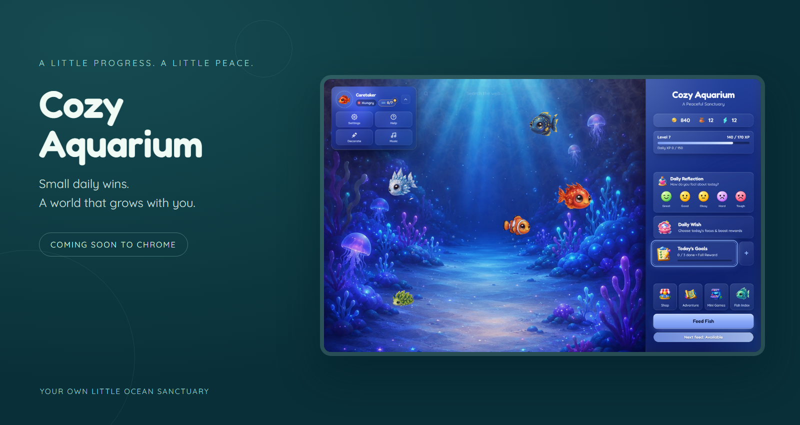
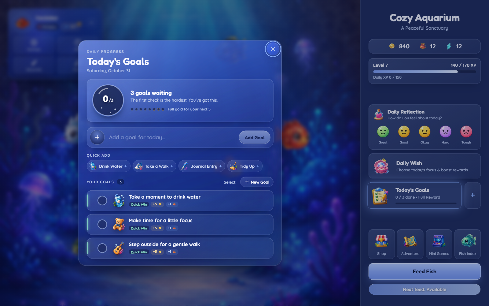
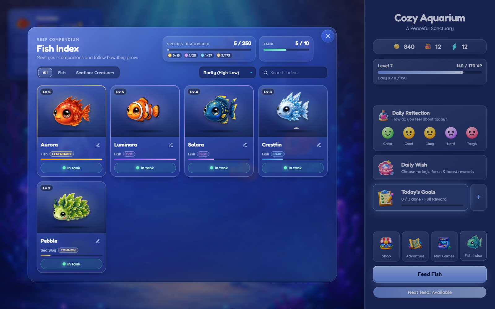
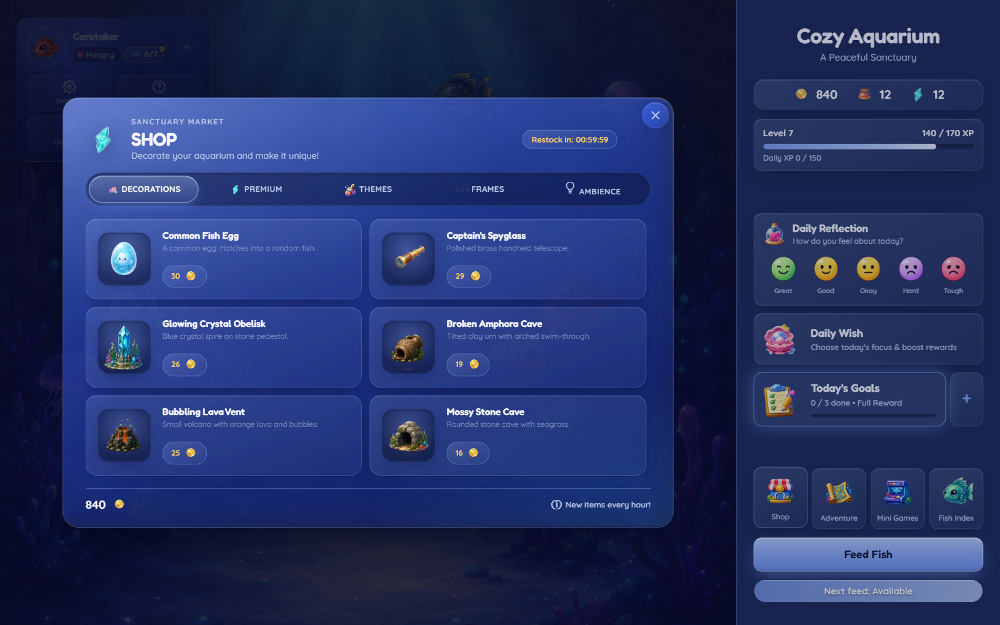
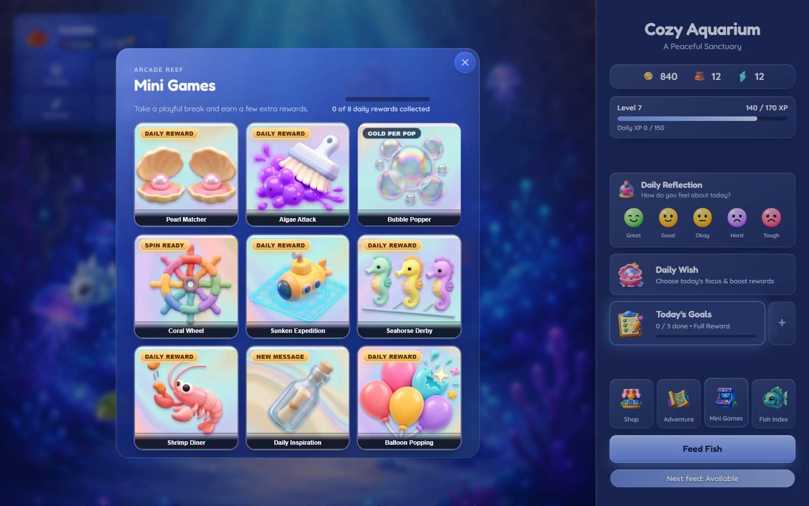
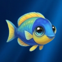

# Cozy Aquarium — Gamified Habit Tracker & Virtual Aquarium for Chrome

  

### A little progress. A little peace.

**Turn everyday goals into a living ocean sanctuary.**

Complete small tasks, care for your creatures, and make a quiet corner of the ocean your own.

 

 

A cozy Chrome extension · Daily goals · Sea creatures · Your own little sanctuary

---

## Small steps, a growing world.

A glass of water. A few minutes of focus. A walk you've been meaning to take.

**Cozy Aquarium gives those little moments a place to grow.** Set your goals, earn in-game rewards, and put them toward an aquarium filled with creatures and details you love. Return for a playful break, a gentle check-in, or simply a moment beneath the waves.

There is always room to start with something small.

### A glimpse beneath the surface

- **Daily goals** — add your own tasks or start with a quick suggestion.
- **Adventures** — break a bigger goal into a journey of smaller steps.
- **Creatures to care for** — hatch eggs, meet new companions, feed them, and watch them level up.
- **A sanctuary to make your own** — explore decorations, themes, and profile customizations.
- **Playful little breaks** — discover an underwater arcade with puzzles, races, and more.
- **Daily reflections** — check in with how you feel and choose a focus for the day.
- **Music and atmosphere** — settle into your aquarium with adjustable sound and visual preferences.

---

## Make room for a small win.

Your list can be as ordinary as life itself: drink water, make time for a little focus, or step outside. Choose what matters today and enjoy the satisfaction of checking it off.

**Looking a little further ahead?** Adventures turn bigger goals into smaller milestones, with templates to help you begin or space to build your own journey.

| A moment in your day | A little step to try |
|:--|:--|
| A fresh start | Pick one thing you'd like to do today |
| Time to focus | Give a task a clear, manageable finish line |
| A pause between things | Check in with how you're feeling |
| A bigger ambition | Build an adventure, one milestone at a time |

---

## Meet your underwater companions.

Hatch an egg and see who arrives. Give your companions names, feed them, and discover creatures of different rarities as your collection grows.

The **Fish Index** keeps your companions together, with their names, levels, and details close at hand. Choose which creatures join you in the tank and give your growing world its own personality.

---

## Find your kind of cozy.

Use the rewards you earn to explore the shop, discover new eggs, and find details for your aquarium. Decorations, themes, and profile touches let your sanctuary gradually become yours.

Some days, a new companion is the reward. Other days, it's simply enjoying the world you've already made.

---

## Take a playful little detour.

Match pearls, pop bubbles, cheer on a seahorse, or try a sunken expedition. The arcade brings a collection of small diversions into your underwater world, alongside a daily message of inspiration.

Earn extra in-game rewards where available, then return to your aquarium whenever you're ready.

---

## Your progress, kept close.

Cozy Aquarium saves progress in your browser profile. In Chrome, progress is also mirrored through **Chrome Sync**, subject to its availability and storage limits.

**Backup export and import** let you keep a separate copy of your progress. The aquarium also includes automatic backup snapshots and can run offline after installation; syncing and opening external links require a connection.

Submitting a query through the aquarium's web search opens Google. For the extension's privacy information and permission disclosures, see its [official Chrome Web Store listing](https://chromewebstore.google.com/detail/cozy-aquarium/laekafildhpmchaekeeglhcadhpcojgm).

---

## Good to know

<strong>Can I install Cozy Aquarium now?</strong>

Yes! Cozy Aquarium is available on the [Chrome Web Store](https://chromewebstore.google.com/detail/cozy-aquarium/laekafildhpmchaekeeglhcadhpcojgm). This repository showcases the extension and does not provide a separate installation download.

<strong>Is it an aquarium or a goal tracker?</strong>

Both. Your aquarium is a place to enjoy, while goals and adventures give everyday progress a playful connection to caring for and growing your sanctuary.

<strong>Can I personalize my aquarium?</strong>

Yes. Choose your active companions, explore decorations and themes, and customize your profile as you progress.

<strong>Does it work offline?</strong>

The aquarium and its bundled activities can run offline after installation. Chrome Sync and external destinations, including web search, need an internet connection.

<strong>Are these screenshots from the real extension?</strong>

Yes. They show the extension interface with sample creatures, goals, and progress. The opening banner frames a real interface capture. Features and visuals may evolve with future updates.

<strong>Is this an open-source project?</strong>

This is a public product showcase. The extension's source code and distribution package are private and are not included here. Public visibility does not grant an open-source license.

---

### Your little ocean is ready.

**Small daily wins. A world that grows with you.**

 

**Available now on Chrome.**

[Install Cozy Aquarium on Chrome](https://chromewebstore.google.com/detail/cozy-aquarium/laekafildhpmchaekeeglhcadhpcojgm)

  

 

Made with care by <a href="https://github.com/Orpheane">Orpheane</a>

---

This repository contains presentation materials only. No extension source code, distribution files, or installation archives are provided. Product names, artwork, and screenshots remain subject to their respective rights.
